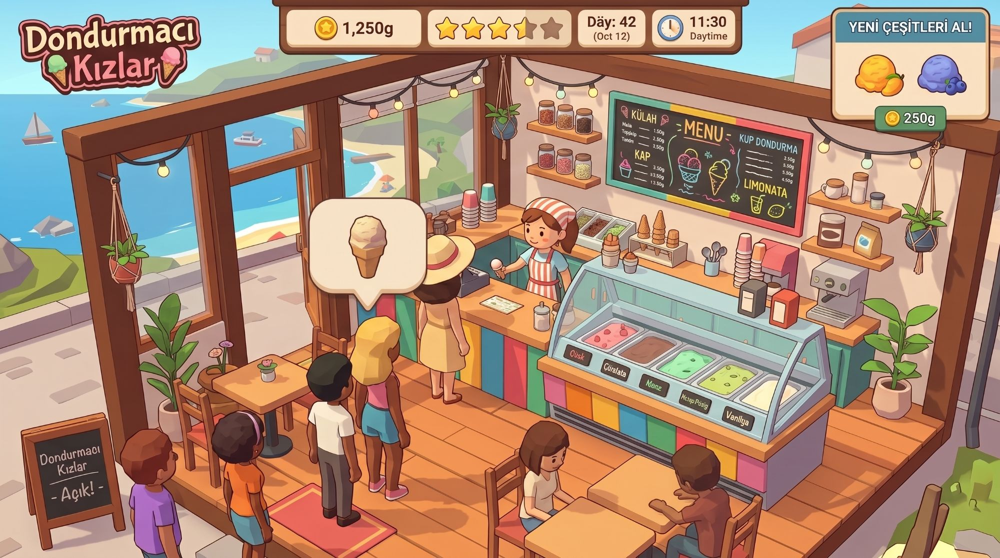
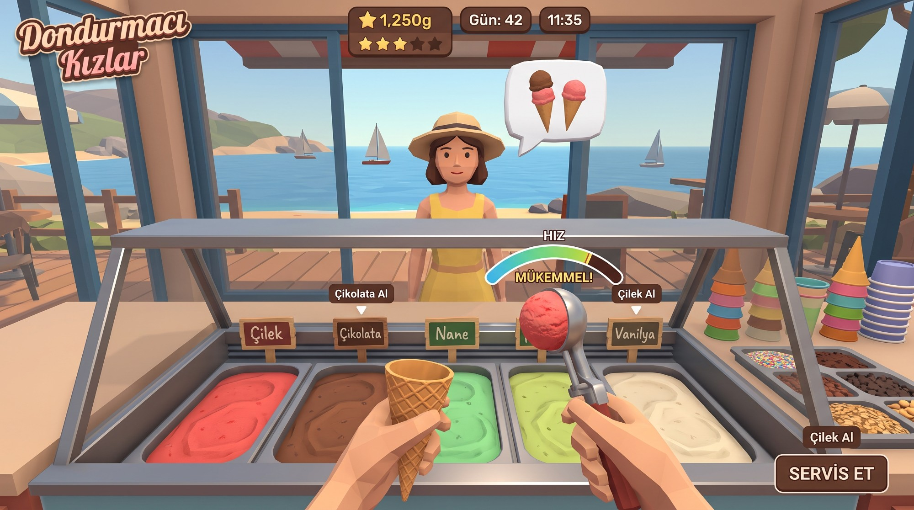
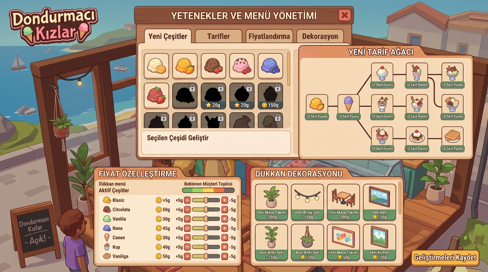

# Dondurmacı Kızlar — Oyun Tasarım Belgesi (GDD)

**Proje:** Dondurmacı Kızlar (Kems Company)
**Aşama:** Oynanabilir sürüm var; görsel kalite ve yeni sistemler sürüyor
**Son güncelleme:** 15 Ekim 2026 — toparlama (bölüm 0.12). Bölüm 0'daki
tarihli kararlar sırayla eklendi; sonradan değişenlerin yanında yeni kararın
bölümü yazar. **Güncel sıra ve açık işler:** `docs/yol-haritasi.md`.
**Açık sorular:** bölüm 7. Taslak görseller `docs/gorseller/` altında
(kanon değil; neyin alınmayacağı oradaki README'de).

| | |
|---|---|
| **Tür** | Cozy casual / tycoon ve elle dükkân işletme hibriti |
| **Platform** | **Önce telefon** (iOS ve Android, tarayıcıdan); PC sonra |
| **Kamera** | İzometrik (yönetim) + sabit birinci şahıs tezgah görünümü (hazırlama) |
| **Görsel stil** | Sevimli, huzurlu low-poly 3D; yumuşak ışık, pastel tonlar |
| **Oyuncu sayısı** | Tek oyunculu |

---

## 0. Kararlar (12 Ekim 2026)

Taslakla çelişen yerde bu bölüm geçerli.

| Konu | Karar |
|---|---|
| Kamera | İki sabit kamera: dükkânın izometrik genel görünümü + sipariş gelince tezgahın arkasından yakın plan; aralarında yumuşak geçiş. **Oyuncu yürümez** |
| 3B | Gerçek 3B modeller, **sabit açılar** (serbest kamera yok) |
| Stil | Low-poly, pastel, yumuşak ışık |
| Platform | Telefon önce; tarayıcıdan bağlantıyla denenir, mağaza ve PC sonra |
| Teknoloji | Web 3B — Three.js |
| 3B modeller | Hazır, ücretsiz, ticari kullanıma açık paketlerle başla (Kenney, Quaternius); beğenilince özel modeller |
| İlk oynanabilir sürüm | Kepçe mini oyunu + müşteri sırası |
| Gün | Oyun içinde saat akar, dükkân kapanınca gün biter |
| Karakterler | Küçük hikâye kırıntıları: müşteri konuşmalarından adadaki olaylar sızar |
| Oyuncu | ~~İsimsiz — oyuncu kendini koyar~~ → 13 Ekim: kişiselleştirilebilir çalışan (aşağıda) |
| Kanon | Liman Mahallesi, iskelenin yakını. Oyun dükkânın **kuruluş hikâyesi** |
| Dönem | 2000'lerin başı |
| Mevsim | Kışın tatlıcı / kafe: menü ve görünüm mevsimle değişir. İlk sürümde değil |
| Para modeli | **Makyaj paketleri satılabilir** (Kemal, 14 Ekim): mevsim paketleri gibi, oyunun görünüşünü değiştiren ürünler ayrıca satılabilir. Ayrıntılar (fiyat, mağaza) sonra |
| Öncelik | Dondurmacı Kızlar önce; The Imperial (resepsiyon oyunu) bekliyor |
| Ekran yönü | **Yatay** (Kemal, 12 Ekim: "yatay olabilir"). Telefon dik tutulsa da oyun yatay görünür (ekran döndürme kilidi açık olabilir); "yan çevir" uyarısı yok |
| Görsel kalite | Taslak görseller temsilî, ama **en az o kalite** hedef (Kemal, 12 Ekim). Ölçü: taslak 2 |
| Tarz | Karışım (Kemal, 12 Ekim): **3B dünya taslak 2 gibi** (temiz low-poly, yumuşak ışık); **arayüz taslak 1 ve 3 gibi** (sıcak, ahşap paneller ve düğmeler) |
| Renkler | Pastel fazla; **Dondurmacı Kızlar renkleri** (logo: mor ve sarı) öne çıksın (Kemal, 12 Ekim). Düğmeler, pencere çerçevesi, vitrin şeridi mor-sarı. Tonlar taslak |
| Kepçe göstergesi | İbre 1,5 sn'de yavaştı; 1 sn'ye indi (Kemal, 12 Ekim) |
| Topların dizilişi | Külahta üst üste, kapta yan yana (üçüncü üste). Başka dizilişler de denenebilir (Kemal, 12 Ekim) |
| Çeşit sayısı | Sonradan artabilir: küvet listesine bir satır eklenince vitrin genişler. Bu açıdan rahat sığan 6; fazlası için ikinci sıra ya da kaydırma gerekir |
| Geri al | "Hata yaptığım zaman geri alamıyorum" (Kemal, 12 Ekim). **Geri al** düğmesi sırayla: kepçedeki topu küvete geri koyar → son konan topu çıkarır. 13 Ekim'den beri altlık ve süsleme için kullanılmaz (doğrudan değiştirilir). Ceza yok |
| Saatin akışı | Saat beşer dakika ilerler. İlk ayar saniyede 5 dakikaydı (Kemal, 13 Ekim: "beş dakikalar saniye gibi aksın"); iPhone denemesinde "günler çok uzun" dendi, Kemal 2 dakika istedi (13 Ekim): her adım **0,77 saniye**. Hafta içi bir gün ≈ 2 dk, hafta sonu ≈ 2,5 dk sürer |
| Çalışma saatleri (yaz dönemi) | **Hafta içi 11:00–00:00, hafta sonu 10:00–02:00** (Kemal, 13 Ekim). Mevsimler gelince kış saatleri ayrıca konuşulacak |
| Genel görünüm açısı | Dükkânın **önünden** (deniz / müşteri tarafından) çekilir; önceki açı 180° ters idi (Kemal, 13 Ekim) |
| Genel görünümde yakınlaştırma | Açı sabit, ama oyuncu **yakınlaştırıp uzaklaştırabilir** (iki parmak, fare tekerleği, + / − düğmeleri); başlangıçta uzaktan (Kemal, 13 Ekim: "insanlar dükkânlarını görebilsinler"). Tezgah görünümü sabit kalır |
| Eksik / fazla süsleme | Altlık ve toplar doğruysa ama süsleme tutmuyorsa dondurma çöpe gitmez: oyun hangi süslemenin eksik ya da fazla olduğunu hatırlatır (Kemal, 13 Ekim) |
| Haftanın günü | 1. gün pazartesi (Kemal, 13 Ekim) |
| Oyunun adı | ~~Dondurmacı Kızlar (13 Ekim)~~ → **henüz karar yok** (Kemal, 15 Ekim, 0.12); şimdilik açılışta dükkânın logosu |
| İlk dört çeşit | **Çilek, Çikolata, Fıstık, Kaymak** (Kemal, 13 Ekim) |
| Para | Adsız jeton (Kemal, 13 Ekim) |
| Oyuncu ve dükkândakiler | **Karar değişti** (13 Ekim): tezgahın arkasında oyuncunun **kişiselleştirebileceği bir çalışan** olur: ten rengi, saç, kıyafet ve önlük, **ad** (oyuncu yazar); parayla yeni kıyafet açılır; vakti gelince şapka, küpe, gözlük gibi aksesuarlar. Dükkânın sahibi (kanondaki kadın, adı yok) **ara sıra gelip dükkânda dolaşır**, şimdilik başka bir şey yapmaz. Eski "oyuncuya ad, yüz verme" kuralının yerine geçer |
| Müşteri sabrı | **Karar değişti** (13 Ekim): yalnız **öndeki** (sırası gelen) müşteri sabırsızlanır. Hiç işlem yapılmadan **oyun saatiyle 80 dakika** (gerçekte ~12 sn; önce yarım saat, sonra bir saatti. Saat 13 Ekim'de hızlanınca Kemal sabrın kısalmamasını istedi: "onu durağanlığın önüne geçmek için koyduk") geçerse sıkılıp gider ve memnuniyete **sıfır yıldız** verir. Herhangi bir işlem (yanlış bile olsa) sabrı sıfırlar. Para kaybı yok. Balonun altında sabır çubuğu (yeşil → sarı → kırmızı). Kapanıştan sonra saat durduğu için sıradakilerin sabrı azalmaz. |
| Hafta sonu | Hafta sonu daha kalabalık (Kemal, 13 Ekim): müşteri aralığı ×0,65 (geçici). |
| Siparişlerin büyümesi | Bazen **iki dondurma**, bazen **birden çok süsleme**; bir şey **açılınca** başlar (Kemal, 13 Ekim). Açılan şey: **Tepsi** (aşağıda) |
| Waffle ve limonata | Şimdilik yok. Gelince **kendi mini oyunları** olur; makineleri **parayla alınıp dükkâna konur**; geliri ve memnuniyeti etkileyen bir yapı düşünülebilir (Kemal, 13 Ekim) |
| Ses | Kodla üretilir, dışarıdan dosya yok (Kemal, 13 Ekim): **deniz ve rüzgâr** (arkada sürekli, gece daha sessiz); **tezgah** (kepçe dalışı, top yerleşmesi, MÜKEMMEL çınlaması, süsleme serpme); **para ve müşteri** (jeton, müşteri tezgaha gelince zil, sıkılıp gidince alçak ses); **düğme tıkları**. **Müzik:** şimdilik kodla basit, sakin bir ezgi; Kemal'in müziği (Suno vb.) gelince yerini alır. Sesler **ilk dokunuşta** açılır (telefonlar dokunmadan ses çaldırmaz). Mola menüsünde müzik ve ses ayarı |
| Gerçek 3B modeller | Hazır paketlere geçildi (0.7, 0.9); kodla çizilmiş parçalar sırayla değişiyor (0.12: mahalle, deniz, kumsal) |
| Eller | **Olmayacak** (Kemal, 14 Ekim: "eller olmasın, bu hali güzel"). Tezgahta yalnız altlık ve kepçe görünür |
| Gün sonu ve gün başı | Gün sonu ekranı kalır, altında yalnız **Tamam**. Tamam'dan sonra dükkânın genel görünümüne dönülür; **Yeni güne başla** ve **dekorasyon / geliştirme** orada. Gün oyuncu başlatınca başlar: günün başında oyuncu dükkânına bakıp vakit geçirebilir, menülere sıkışmaz (Kemal, 13 Ekim). |
| Altlık değiştirme | Külah / kap / kup arasında her an doğrudan geçilir, Geri al gerekmez; konmuş toplar ve süslemeler yeni altlığa geçer (Kemal, 13 Ekim). |
| Süsleme kaldırma | Aynı süslemeye yeniden basınca o süsleme kalkar; süsleme için Geri al gerekmez (Geri al yalnız kepçedeki ve konmuş toplar için kalır). Bir dondurmaya birden çok süsleme gelebilir (Kemal, 13 Ekim). |
| Dekorasyon türleri | İki tür (Kemal, 13 Ekim): **genel** (ör. ışıklandırma; tek tip, daha pahalı üst seviyeleri olabilir) ve **taşınabilir** (ör. masa takımı: alınır, yerini oyuncu elle seçer; kareli yerleştirme düzeni önerildi). Taşınabilir eşyalar **dükkânın içine de önüne (terasa) de** konabilir (Kemal, 13 Ekim). Dekorasyon uzun soluklu bir alan. Yapıldı (bölüm 0.1–0.4, 0.11) |
| Kapı ve müşteri yolu | Dükkânın önünde (teras / iskele tarafında) bir **kapı** olur. Müşteriler havadan belirmez: kameranın dışından **iskele boyunca yürüyerek** gelir, kapıdan girer, sıraya geçer; giderken kapıdan çıkıp yürür. Hep aynı taraftan gelmezler, iki yönden de gelirler (Kemal, 13 Ekim) |
| Dekorasyon | **Genel:** ışıklandırma üç seviye — 1 fenerler, 2 terasa asma ampuller, 3 dükkân önünde ışıklı mor-sarı şerit; her seviye öncekinden pahalı. **Taşınabilir:** masa takımı, şemsiyeli masa, çiçek saksısı; alınınca depoya gider, gün başında "Yerleştir" ile kareli zeminde bir kareye konur (terasa ve içeri); konmuş eşyaya dokunulunca yeniden seçilir, başka yere taşınır. Müşteri yolu ve kapı önü boş kalır. Yerleştirilen her eşya ve her ışık seviyesi müşterileri biraz daha sık getirir. Fiyatlar geçici |
| Genel görünümde kamera | **Değişti (Kemal, 14 Ekim):** "360 döndürme ve aşağı yukarı bakma, her yerde". Genel görünümde her an, alışılmış harita düzeniyle (Kemal, 14 Ekim): **tek parmak** kaydırır (açı değişmez, dükkândan uzaklaşamaz); **iki parmak açıp kapama** yakınlaştırır (sınırlı); **iki parmağı çevirmek** dükkânın çevresinde döndürür; **iki parmakla birlikte yukarı aşağı sürüklemek** eğer (alçak bakıştan neredeyse tepeden bakışa). İki parmakta önce belirginleşen hareket, parmaklar kalkana dek tek başına çalışır; birbirine karışmaz. Farede sol tuş kaydırır, sağ tuş döndürür ve eğer, tekerlek yakınlaştırır. Sol alttaki **ortala** düğmesi baştaki görünüme döndürür. Tezgah yakın planı sabit kalır. (13 Ekim'deki "tek parmak kaydırır, açı değişmez" kuralının yerine geçer) |
| Tezgah düzeni | Dar telefon ekranında külah çikolata küvetini kapatıyordu (Kemal, 13 Ekim). Kamera biraz aşağı eğildi, küvetler ekranda yukarı çıktı; külah küvetlerin üstüne, sola alındı |
| Duraklatma menüsü | Sol üstte duraklat düğmesi (Kemal, 13 Ekim). Saat, müşteriler ve sabır durur. Menüde: **Devam et**, **Dükkânı gez**, **ses ayarı** (müzik ve sesler; ses henüz yok, ayar saklanır) |
| Dükkânı gezme | Duraklatınca dükkânın çevresinde **parmakla döndürülür**, yakınlaştırılır; bakılan yöne dönük duvarlar kalkar. 14 Ekim'den beri genel görünümde de döndürülebiliyor; gezmenin farkı duvar ve ışık seçenekleri ile fotoğraf |
| Gezerken duvarlar | Tek düğme sırayla değiştirir (Kemal, 13 Ekim): **Kesit** (bakılan yöne dönük duvarlar kalkar) → **Duvarsız** (hepsi kalkar) → **Kapalı** (bütün duvarlar ve tavan yerinde; dükkâna tümden dışarıdan bakılır) |
| Gezerken gece / gündüz | Dükkânı gezerken bir düğme ışığı sırayla değiştirir: şimdiki saat → gündüz → akşam → gece (Kemal, 13 Ekim). Yalnız görünüş; oyunun saati değişmez |
| Deneme parası | ~~`#deneme` ile +5000 düğmesi~~ → **kaldırıldı** (15 Ekim, 0.12): yerini 10.000 jeton ve Deneme dükkânı aldı. `#hizli` (30 sn gün) da kaldırıldı |
| Fotoğraf | Gezerken **Fotoğraf çek**: o anki görüntü gösterilir ve galeriye girer (0.12, 5. adım); telefonda resme basılı tutarak kaydedilir (Claude önizlemesinde İndir düğmesi çalışmaz, yayın bağlantısında çalışır) |
| Sipariş balonu | Müşterinin başının sağında, aşağı doğru açılır (üstteki ipucuyla çakışmasın; 13 Ekim) |
| İpucu yazısı | Üst sıranın altında, ortada; dili sıcak (Kemal, 13 Ekim: "üst üste gelmiş, çok soğuk") |
| Tepsi | Dükkânı geliştir → Yeni çeşitler'den **Tepsi** (geçici 400) alınınca siparişlerin bazıları **iki dondurma** ya da **iki süsleme** ister. İki dondurmalı siparişte ilk dondurma hazırlanınca **Tepsiye koy**'a basılır, sonra ikincisi hazırlanır, Servis et ikisini birden verir. Balonda iki dondurma yan yana görünür. Sıra kural değil |
| Çalışan | Tezgahın arkasında, genel görünümde görünür (tezgah görünümünde kameranın yerinde olduğu için görünmez). Gün başında **Çalışan** düğmesiyle sağda panel açılır, kamera çalışana yaklaşır: ad, ten (5), saç (kısa, uzun, topuz, kıvırcık; 6 renk), önlük (mor, sarı, krem; parayla çizgili 150, puantiyeli 200), aksesuar (parayla küpe 100, bandana 120, gözlük 160, kasket 180; başa tek şey). Adı genel görünümde başının üstünde yazar. Kepçe dalarken öne eğilir. Fiyatlar geçici; çalışana hikâye yazılmaz |
| Sahibi | Günde bir kez, rastgele bir saatte iskeleden gelir, kapıdan girer, dükkânda ve terasta biraz dolaşıp gider; başka bir şey yapmaz. Görünüşü **geçici** (mor elbise, topuz saç); kanonda görünüşü yok, Kemal belirleyecek |
| Alanlar | (Kemal, 14 Ekim) Dükkânın **iki yanındaki boş alanlar** ve **yol kenarındaki teras** satın alınır; yalnız **dükkânın hizasındaki** teras başta açıktır. Alınan alana eşya konur; yan alan alınınca ahşap zemin döşenir. Dört alan: iki yan, iki yol kenarı. Yerleştirirken kilitli kareler gri görünür |
| Dış süsler | (Kemal, 14 Ekim: "dükkân dışı için tabela benzeri ürünler; dekorasyonda market çok zayıf") Dokuz yeni eşya: bank, çöp kutusu, çiçekli kasa, ayaklı kara tahta, flama direği, sokak lambası, sepetli bisiklet, ışıklı tabela, dev külah. Hepsi **yalnız dışarıya** konur (şemsiyeli masa da). Tabela ve kara tahtada **yazı yok**, yalnız dondurma çizimleri. Bankta iki müşteri oturabilir. Mağazada iki başlık: "Oturma ve çiçek", "Dükkânın dışı için" |
| Çeşitler (14 Ekim) | **29 çeşit**, zamanla açılır (Kemal: "24'ten fazla"; liste Claude'un önerisi, Kemal onayladı). Baştan açık: kaymak, çikolata, çilek, fıstık. Parayla: mango, yaban mersini (dönem için az yaygın ama kalsın, Kemal), limon, vişne, kavun, karpuz, muz, kahve, fındık, karamel, portakal, kayısı, şeftali, hindistan cevizi, nane, böğürtlen. Memnuniyetle **satın alınabilir** olanlar: ortalama **4** yıldızda ahududu, bitter çikolata, tarçın, ballı yoğurt; **4,5**'te karadut, sakızlı, incir; **4,75**'te gül, kestane. Eşik en az 10 müşteriden sonraki en iyi ortalamaya bakar; bir kez açılan kapanmaz |
| Vitrin (14 Ekim) | **4 küvetle başlar**, Dükkânı geliştir'den 6, 8, 10, 12'ye büyür; 6'dan fazlası iki sıra. Gün başında **Vitrin** ekranı: çeşide dokunarak elle seçilir ya da **Otomatik** (her sabah dünün en çok satanları + bir yeni çeşit). Müşteriler **yalnız vitrindekileri** ister. Her küvetin önünde çeşidin adı yazan kart var (arka sırada çubukta); sipariş balonunda da adlar yazar |
| Işıklı tabela | Üstünde dükkânın adı: "Dondurmacı Kızlar" (Kemal, 14 Ekim) |
| Çeşit fiyatları (sonraki parça) | Genel fiyat (ucuz / normal / pahalı) kalır; Fiyat ekranı ayrıntılanır: **her çeşidin kendi fiyat çubuğu** ve hepsini birden ayarlayan çubuk. Pahalı çeşit daha seyrek istenir (Kemal, 14 Ekim). Fiyat ekranında: genel seviye, "Hepsi" çubuğu, "Makul fiyatlara dön", her açık çeşidin çubuğu (5–25), müşterinin ödediği fiyat ve "çok istenir / olağan / az istenir". Makul fiyat: klasik 10, 4 yıldızlılar 12, 4,5'lar 14, 4,75'ler 16. Makulün %20'sinden pahalısı memnuniyeti biraz düşürür (sayılar geçici) |
| Eğitim (14 Ekim) | **Yazısız el işareti**. İlk siparişte üç adım (altlık → küvete basılı tut → servis et); sonra **ilk kez görülenlerde** birer kısa işaret (ilk süslemeli sipariş, ilk tepsi, ilk vitrin seçimi). İlk sipariş boyunca **saat durur, tek müşteri** gelir, sabır azalmaz. Köşede **Geç** düğmesi; Ayarlar'da (şimdilik mola menüsünde) "Eğitimi yeniden göster" |
| Menüler (14 Ekim) | Tam ekran pencere kalır ama **resimli**: kartlarda eşyanın oyundaki modelinden **küçük 3B resmi**, az yazı. Ekran boş grafiklerle harcanmasın (Kemal: "özellikle dekorasyon bölümünde") |
| Satın alınca (14 Ekim) | Eşya alınınca küçük bir ekran çıkar: **Yerleştir** ya da **Alışverişe devam et**. Devam edilirse eşya depoya gider, sonra istenince yerleştirilir |
| Tezgah küvetleri (14 Ekim) | Çok küvette dokunma alanları küçük kalıyordu. Vitrin **yanlara genişler**, tezgah kamerası **biraz dikleşir**; iki sıra kalır, küvetler büyür, düğmeler kenarlara çekilir |
| Oyun hissi (14 Ekim) | Parçacık efektleri **orta, sakin**: mükemmel topta kısa kıvılcım, doğru serviste kasaya uçan birkaç jeton, süslemede serpinti, sıkılan müşteride küçük bulut. Ekran sarsma yok. **Titreşim yok** |
| Yatay sipariş balonu (Kemal, 14 Ekim) | Balon uzayıp küvet etiketlerinin üstüne biniyordu: yatay olur (solda dondurma resmi, sağda adlar ve sabır çubuğu). 5. paketle birlikte |
| Bahşiş (14 Ekim) | Arka arkaya mükemmel servislerde müşteri küçük **bahşiş** bırakır; seri bozulunca ceza yok, sessizce sıfırlanır |
| Yardımcı çalışan (14 Ekim) | Parayla bir **yardımcı çalışan** alınabilecek (ör. masaları toplar, waffle makinesine bakar). **Assetlerden sonra**, makinelerle birlikte tasarlanır |
| Açılış ekranı ve Ayarlar (14 Ekim) | Açılışta arkada dükkânın sakin görünümü, önde **logo**, **Oyna** ve **Ayarlar**. Logo dosyasını **Kemal gönderecek**. Ayarlar: müzik ve ses, eğitimi yeniden göster, baştan başla (onaylı), dil (Türkçe / English, 6. adım), **ekran ayarları**: küvet etiketlerini ve sipariş balonundaki çeşit adlarını gösterme / gizleme (Kemal, 14 Ekim) |
| Makineler (14 Ekim) | Waffle ve limonata makineleri + yardımcı çalışan **assetlerden sonra** |
| Assetler (14 Ekim) | Önce **ücretsiz paketler** (Kenney, Quaternius; CC0). Claude indirir, yerleştirir, `docs/lisanslar.md`'ye yazar; Kemal'in bir şey yüklemesi gerekmez. **İlk karakterler** değişir (müşteriler, çalışan, sahip; yürüme ve oturma hareketleriyle) |
| Kroki | *Yerini 0.10 (Liman haritası) aldı.* Kemal paylaştı (14 Ekim, `docs/gorseller/kroki-liman.webp`): dükkân sahil yolunun deniz tarafında, **T biçimli iskelenin karşısındaki küçük kare** (yaklaşık 15–18 m). Krokide dükkânla deniz arasında kum var; oyunda **şimdiki ahşap teras kalır** (Kemal: "şimdiki kalsın"). Bugünkü düzen zaten yakın |
| Logo | Kemal gönderdi (14 Ekim): `public/gorseller/logo-kulahli.webp` (külahlı) ve `logo-yazi.webp` (yalnız yazı). Yazı kırmızı-krem, logonun asıl zemini **mor ve sarı**: oyunun renkleri **mor-sarı kalır**. Kullanılacak yerler: **açılış ekranı, ışıklı tabela, dükkânın ön cephesi (tentenin üstü), menü başlıkları**; yerine göre külahlı ya da yalnız yazı |
| Büyüme (14 Ekim) | Soru turuyla planlandı: aşağıda **bölüm 0.1**. Bugünkü "Alanlar" satın alması bu planla değişecek. **Assetlerden sonra** yapılır |
| Arayüz sıkışık (Kemal, 14 Ekim, telefon görüntüleriyle) | "Düğmeler inanılmaz büyük, çok fazla yer kaplıyor. Menü sistemi yok, her şey ortada." Düğmeler küçülecek; gün başı düğmeleri (Dükkânı geliştir, Vitrin, Yerleştir, Çalışan) tek bir menü düzeninde toplanacak; tezgahta altlık, süsleme, Geri al, Servis et daha az yer kaplayacak. 4. maddeyle (resimli menüler) birlikte ele alınır |
| Etiket boyu (Kemal, 14 Ekim) | Küvetlerdeki ad kartları ve sipariş balonundaki çeşit adları "inanılmaz büyük": küçülecek. Ayarlar'daki ekran ayarlarından ikisi de kapatılabilecek |
| Kış paketi (Kemal, 14 Ekim) | Aciliyeti yok: oyun hazır olduğunda, dönemi gelince yapılır |
| İş sırası (14 Ekim) | *Bitti; güncel sıra `docs/yol-haritasi.md`.* 1. Eğitim → 2. Tezgah küvetleri (vitrin yanlara, kamera dik) → 3. Çeşit başına fiyat ekranı → 3b. Etiketleri küçült → 4. Menü sistemi + küçük düğmeler + resimli menüler + "Yerleştir / devam et" ekranı → 5. Efektler + bahşiş + yatay balon → 6. Açılış ekranı + Ayarlar (logo gelince) → 7. Assetler (önce karakterler) → 8. Makineler + yardımcı çalışan → 9. Büyüme yapısı |
| Masalarda oturan müşteriler | (Kemal, 14 Ekim: "misafirler arada varsa masalara otursun") Dondurmasını alıp mutlu giden müşterilerin bir kısmı boş bir masa varsa oturup yer, sonra iskeleden gider. Tezgahın arkasındaki köşelere konan masalara oturulmaz |
| Sonraki iş sırası (14 Ekim) | *Bitti / yerini büyüme planı aldı; güncel sıra `docs/yol-haritasi.md`.* 1. Alanlar + masalarda oturan müşteriler → 2. Dükkân dışı için tabela benzeri yeni dekorasyon ürünleri (market zayıf kaldı) → 3. Çok çeşit dondurma (Türkiye'de 20 çeşit olağan): çeşitler zamanla açılır, vitrine sınırlı küvet sığar, **her sabah vitrine hangi çeşitlerin gireceği seçilir** (önerildi, onay bekliyor) → 4. **Kış paketi:** dükkân tatlıcı / kafe olur, kışın yalnız **sıcak çikolata** istenir; makyaj paketi olarak satılabilir |
| Topların sırası | Kural değil: yalnız altlık, çeşitler ve top sayısı tutmalı (13 Ekim) |
| Deneme telefonu | Elde hangisi varsa; orta seviye bir telefonda akıcı çalışmak hedef |

---

## 0.1 Büyüme planı (Kemal, 14 Ekim soru turu)

*Yapıldı (0.2–0.5).* Sayılar geçici; 7. adımdan beri `src/oyun/ayarlar.json`'da (0.12).

**Arazi**
- Dükkânın sağı, solu ve arkası **eşit dilimlere** (~4 m) bölünür; her dilim ayrı alınır.
- **Üst sınır yok:** krokideki dükkân sınır değil; sağa sola boş arazi oldukça büyüme sürer.
- Oyun **bugünkü boyutla** başlar. Dekorasyon yalnız dükkânın önündeki hizaya konur; yeni yerler satın alınır.
- **Yürüyüş yolu deniz tarafına alınır**, böylece her dilimin önü büyür. Bir dilim alınınca önü de oyuncunun olur. Yalnız alınmış dilimlerin önü kullanılır.
- Fiyat **her alımda artar** ve **yere göre** değişir: ön ve iskele tarafı pahalı, arka ucuz.

**Aşamalar (her biri ayrı ödeme)**
1. **Dilimi al.** Önce açık alan olur, masa ve dekorasyon konur.
2. **Duvar ör.** Dilim kapalı alana katılır. Şimdilik **anında** olur. Oyun çıkınca bir süre konur ve hızlandırma için ödeme yapılabilir (Kemal).
   - Pencere ve kapı kendiliğinden gelir (önde cam vitrin), sonradan değiştirilebilir.
   - Kapalı alan **ücret ödenerek** tekrar açık alana çevrilebilir.
3. **Mutfak (arka dilimler).** Duvarla kapatılan arka dilim, bir ödeme daha ile mutfağa katılır.
   - Mutfak önce **yalnız alan** verir, sonra alınanlar eklenir: makineler, yardımcı çalışanın yeri, depo (vitrinden ayrı, daha çok çeşit stokta).

**Kapalı alan ne işe yarar**
- İç masalar. Kışın, paket gelince yalnız içerideki masalar kullanılır.
- Makine yeri: waffle ve limonata makineleri.
- Daha uzun sıra, yani daha çok müşteri.
- İç dekorasyon: duvar süsleri, raflar, lambalar.

**Tezgah**
- Tezgah da dekorasyon gibi **modüler parçalarla** kurulur: düz, köşe, vitrinli, süsleme, makine.
- Parçalar alınıp kapalı alanda kareye konur. Kemal'in hayali: arka duvardan gelen, **önü açık U biçimi** bir dükkân.
- Tezgah uzayınca gelenler:
  - daha büyük vitrin (12'den fazla küvet olabilir),
  - **ikinci servis noktası,**
  - ayrı süsleme ya da makine tezgahı.

**İstasyonlar**
- Tezgah yakın planı **istasyonlara** bölünür: vitrin, süsleme, makine…
- **Sabah oyuncu bir istasyon seçer**, o gün onu oynar.
- Yardımcı çalışan yokken öteki istasyonlar **kapalı** kalır. Yardımcılar alındıkça açılır ve **yeteneklerine göre** o istasyonlarda çalışır.

**Ekran**
- Gün başında **İnşaat modu**: dükkâna üstten bakılır, dilimler renkli görünür.
- Dilime dokununca seçenekler ve fiyat çıkar: Al / Duvar ör / Mutfağa kat / Tezgah parçası koy.

### 0.2 Büyüme soru turu 2 (Kemal, 14 Ekim akşam)

0.1'i şu cevaplar netleştirir; çelişirse **bunlar geçerli**.

| Konu | Karar |
|---|---|
| Ön teras | Yol deniz tarafına kayar. **Ön teras da satın alınır**: başta yalnız dükkânın içi ve kapının önü açık |
| Arazi biçimi | **Kare kare** (~4×4 m). Her kare ayrı alınır |
| Alma sırası | Yalnız sahip olunan yere **komşu** kare alınır; arada boşluk kalmaz |
| Kamera | Dükkân büyüdükçe genel görünüm **kendiliğinden geri çekilir**; yakınlaştırma yine oyuncuda |
| İnşaat modu | **Yalnız gün başında** (müşteri yokken) |
| Renkler | Trafik ışığı: alınmış **yeşil**, alınabilir **sarı**, alınamaz **gri** |
| Duvar örülünce | İçeriye uymayan dış eşyalar **depoya döner**; içe uyanlar yerinde kalır |
| Kapı | Bugünkü kapı yerinde kalır. Ön duvar yeterince uzayınca (ör. 3 kare) **ikinci kapı** alınabilir; müşteri yakın olandan girer |
| Fiyat ölçüsü | **Bugünkü gibi**: ilk kare ~150–250, her alımda biraz artar; ön / iskele tarafı pahalı, arka ucuz |
| Duvarı yıkmak | **Ücretli**, duvara ödenen para geri gelmez |
| Eski "Alanlar" | Eski alınan yerin üstüne düşen kareler oyuncunun olur, eşyalar yerinde kalır |
| Boş mutfak | Fayans zemin, boş; makine ve depo geldikçe dolar |
| Uzun sıra | **Duvarla birlikte**: her kapalı kare sıraya yer ekler |
| İç masalar | Müşteriler dış masalar gibi iç masalara da oturur |
| İş sırası | 1) Kareler + yol denize + İnşaat modu + Al → 2) Duvar ör / yık + uzun sıra + ikinci kapı → 3) Mutfağa kat → sonra 3b (tezgah parçaları, istasyonlar, makineler, yardımcı). Her adım ayrı PR |

### 0.3 Ölçü ve tezgah bölümü (Kemal, 14 Ekim gece soru turu)

0.1 ve 0.2'yi şu kararlar netleştirir; çelişirse **bunlar geçerli**.

| Konu | Karar |
|---|---|
| Ölçü birimi | **Her şey 1×1 m'lik birimle.** Küsurat yok (Kemal: "küsurat istemiyorum") |
| Arazi karesi | **4×4 m**, içi **16 adet 1×1 m** eşya yeri (Kemal kararı Claude'a bıraktı: 4×4 bugünkü dükkâna ve alınmış karelere tam oturuyor) |
| Dükkân | **8×4 m** (2 kare). Önde 1 m müşteri sırası, arkada 8×3 m tezgah bölümü. Arka duvar 4,45'ten 4 m'ye gelir |
| Ön teras | 4 m (1 kare sırası) |
| Zemin | Dışarısı (teras ve alınan açık kareler) **1 m genişlikte, aynı hizada ahşap tahta**; yan yana kareler tek zemin gibi. İçerisi başka (koyu ahşap) |
| Eşya boyu | **Boyuna göre:** küçükler 1×1 (saksı, çöp kutusu, flama, sokak lambası, kara tahta, ışıklı tabela, külah figürü); bank, bisiklet, çiçekli kasa 2×1; sandalyeli masa ve şemsiyeli masa 2×2. Yerleştirirken **çevir** düğmesi |
| Tezgah bölümü | Bugün kullanılan çalışma alanı (vitrinli tezgah, arka tezgah, çalışanın yeri; 8×3 m) **tek parça**. Önünde hep 1 m müşteri sırası kalır, önü hep denize dönük |
| Taşıma | **İnşaat modunda, ücretsiz**; kapalı alanda her yere, 1 m adımlarla (ileri, geri, sağa, sola). Tezgah yakın planı ve müşteri sırası onunla birlikte gider. Altında kalan eşyalar depoya döner |
| Boy | İnşaat'ta **1 m adımlarla uzatılır / kısaltılır, 4–16 m**. Her yeni metre ücretli (80, geçici), kısaltmak bedava; bir kez alınan metre tekrar uzatınca yeniden ödenmez |
| 3b ile ilişki | Tek parça kalabilir; ileride gelecek modüler tezgah parçaları (köşe, süsleme, makine…) yanına eklenebilecek biçimde |
| Ne zaman | **Bu adımda.** Bugünkü 8×4 dükkânda yer yok; kısaltınca yana kayabilir, duvar adımıyla kapalı alan büyüyünce her yöne taşınır |

### 0.4 Duvar, pencere, kapı (Kemal, 14 Ekim gece soru turu)

| Konu | Karar |
|---|---|
| Duvar parçaları | Her duvar **1 m'lik parçalardan** oluşur. İnşaat'ta parçaya dokununca: düz duvar / pencere / kapı (kapı yalnız ön, yani denize bakan duvarda). Yan yana pencereler geniş bir cam gibi birleşir |
| Başlangıç | Yan duvarların (sağ, sol) ortasında **2 m pencere** hazır gelir; eski kayıtlarda da (Kemal: "sağ sol duvarlar çok kapalı yapıyor dükkânı"). Ön duvar eskisi gibi cam vitrin, arka duvar düz |
| Pencere ücreti | 1 m pencere **40** (geçici); düz duvara geri çevirmek bedava |
| Duvar ör / yık | Kare başına **150 / 50** (geçici; Kemal "daha ucuz" seçti). Yıkımda para geri gelmez. Duvar örülünce içeriye uymayan dış eşyalar depoya döner; içerinin zemini koyu ahşap |
| İkinci kapı | **Her zaman** alınabilir, **250** (geçici); ilk kapı bedava. Kapı düz duvara geri çevrilebilir, ama en az bir kapı kalır. Müşteri tezgaha yakın olan kapıdan girer |
| Sıra | Her kapalı kare sıraya yer ekler (0.2) |
| Ön teras | **Duvar örülmez** (Kemal, 14 Ekim: "yürüyüş yolunun yanındaki teras kısmı kapanmamalı, teras duvarsız kalmalı, yaz kış"). Ön teras sırası alınır, masa ve eşya konur ama hep açık kalır. Daha önce kapatılmışsa açılır, kapı dükkânın ön duvarına geri gelir |

### 0.5 Mutfak, tezgah parçaları, istasyonlar, makineler, yardımcı (Kemal, 14 Ekim gece soru turu)

Kalan büyüme işleri **tek pakette** (Kemal: "paketleri birleştirebilirsin, bol ekran görüntüsüyle").

| Konu | Karar |
|---|---|
| Mutfak | **Açık mutfak**: arka kapalı kare "Mutfağa kat" ile mutfak olur (kare başına **100**, geri çevirmek 50; geçici). Fayans zemin, dükkânla arası duvarsız, sınır çizgisi; müşteri girmez, masa konmaz, tezgah bölümü üstüne gelmez |
| Depo | **Şimdilik yalnız görüntü** (raflar, buzdolabı, kutular); oyuna etkisi sonra (Kemal: "sonranın işi olsun") |
| Tezgah parçaları | İnşaat'ta tezgah bölümünün sağ ya da sol ucuna eklenir / çıkarılır: **waffle makinesi** (600), **limonata makinesi** (400), **ikinci vitrin** (12'den fazla küvet), **ikinci servis noktası**, **köşe** (süs; U biçimi görünüşü için, işlevi yok). Bir kez alınan parça çıkarılıp yeniden eklenince tekrar ödenmez. Fiyatlar geçici |
| İkinci servis noktası | **Dondurma için değil, waffle ve limonata için** (Kemal). Önünde ikinci bir müşteri sırası oluşur; makine ürünleri buradan satılır |
| Waffle | Hamur dök (basılı tut, çizgide bırak) → kapak kapanır, renk çubuğu dolar, **altın sarıda aç** (erken soluk, geç yanık) → süsle → servis. Satış 6 (geçici) |
| Limonata | **Yalnız bardak doldur**: musluktan doldur, çizgide bırak, istenirse buz ekle → servis. Satış 3 (geçici) |
| İstasyonlar | Belgedeki gibi: güne başlarken oyuncu bir istasyon seçer (dondurma / waffle / limonata). Yalnız açık istasyonların ürünlerini isteyen müşteri gelir: oyuncunun istasyonu + yardımcıların istasyonları. Yardımcı kendi istasyonunun siparişlerini kendisi yapar |
| Yardımcı | İşe almak **300** + gün sonunda **yevmiye 40** (para 0'ın altına inmez; ceza yok). Her yardımcının iyi olduğu bir istasyon ve hızı (1–3 yıldız) var; işe alırken 3 aday. Görünüşü müşterilerle aynı Kenney parçalarından, önlüklü; **adını oyuncu yazar** |

### 0.6 İçecek standı, waffle süslemesi, ikinci vitrin (Kemal, 14 Ekim gece)

0.5'i şu kararlar değiştirir.

| Konu | Karar |
|---|---|
| İçecek standı | Limonata sebili "tek başına çok çıplak kaldı": yerine **içecek standı**. Şimdilik **yalnız kutu / şişe içecekler** (gazoz, kola, soda, vişne suyu, şeftali suyu; geçici): müşterinin istediği içecekleri dolaptan alıp servis et. Fiyatı Fiyat ekranından |
| İleride ayrı istasyonlar | Limonata, ayran, buzlu çay (doldurma); milkshake / frappe; kahve (barista; kışın kafeye geçişin başlangıcı); taze sıkma meyve suyu. "Acil değil", sonra karar verilecek |
| Waffle süslemesi | Üç grup: **çikolata** (sütlü, bitter, beyaz), **meyve** (çilek, muz, kivi, böğürtlen), **süsleme** (fındık, renkli şeker, hindistan cevizi, pudra şekeri). Müşteri **serbestçe birden çok** isteyebilir (aynı gruptan iki tane de) |
| Müşteri alanı | Tezgahla önündeki duvar arası **en az 1 m** (bugünkü kural; 1,5 m için tezgah 4 m'lik dükkâna sığmıyordu) |
| İkinci vitrin | **Kaldırıldı** (Kemal: "sevmedim"); vitrin en çok 12 küvet. Satın alınmışsa parası geri verilir |
| Assetler | Müşterilerin boyu tezgaha yetmiyor; karakterler, duvarlar, ürünler için yeni paketler. Claude aday listesini resimleriyle hazırlar, **Kemal seçer**; seçilmeden eklenmez |

### 0.7 Tasarım dili ve hazır paketler (Kemal, 14 Ekim)

Kemal'in seçtiği paketler: K2 Ultimate Modular Women + Men (Quaternius),
M1 Furniture Kit (Kenney), M2 Bakery Interior (Tiny Treats), M4 Restaurant
Bits (KayKit), G1 Food Kit (Kenney), D1 Watercraft Kit (Kenney), D4 City Kit
Commercial (Kenney), D7 Stylized Nature MegaKit (Quaternius). Paketler
olduğu gibi kullanılır; Blender yalnız bozuk ya da biçimi uymayan model için.
Hepsini tek oyun gibi göstermek için tasarım dili (onay: 14 Ekim):

| Konu | Karar |
|---|---|
| Palet | Oyundaki renkler (`src/sahne/renkler.ts`) + dört yeni ton: fayans, tekne mavisi, kiremit, pembe sıva. Dondurma, meyve, içecek renkleri olduğu gibi kalır; ekranın en canlı şeyi ürünler |
| Mor ve sarı | **Yalnız bizim dükkânın** (logo, tente, menü, önlük). Liman'daki öteki binalar, tekneler, sokak eşyaları almaz |
| Renk kuralları | Her renk paletten; saf siyah ve beyaz yok; bir eşyada en çok bir canlı renk |
| Işık ve yüzey | Tek sıcak güneş + gökyüzü dolgusu; her şey mat (cam ve metal hafif parlar); köşeli görünüm; doku yalnız zemin tahtası ve fayansta; gölgeyi yalnız büyük eşyalar ve insanlar verir; siyah kontur yok |
| Ölçü | 1 m ızgara. Yetişkin 1,70 m (1,55–1,85 karışık), çocuk 1,10–1,30, tezgah 0,95, masa 0,75, oturak 0,45, kapı 2,15, tavan 3,25 |
| Nasıl | Oyun her modeli yüklerken boyunu ölçüye getirir, renklerini palete çevirir (renk tonu paletten, açıklık modelin kendisiyle paletinkinin karışımı), yüzeyini mat yapar. Yanlış tona giden renkler için parça başına küçük bir **boya tablosu** ("şu renge yakın her şey şu renge"); Kenney paketlerinin hepsi aynı renk tablosunu paylaştığı için tek tablo yeter (`src/sahne/tasarimDili.ts`) |
| Sıra | 1) tasarım dili sayfası (onaylandı), 2) her paketten 2–3 parça önce / sonra denemesi, 3) oyuna yayma (karakterler K2 ile değişir, boy sorunu böyle çözülür) |

### 0.8 Yol haritası, test kolaylıkları, ekran (Kemal, 14 Ekim gece soru turu)

Kemal: "acelemiz yok; bir şirketmiş gibi yerimizi, noktamızı ve yolumuzu bilmek
isterim." Sıralama Claude'da; Kemal "şimdi" demedikçe işler bu sırayla gider.

| Paket | İçerik |
|---|---|
| A | Test kolaylıkları ve ekran: 10.000 jeton, açılış ekranı (Yeni oyun / Devam et / Deneme dükkânı), döndürme ve duvar düğmeleri, haber şeridi |
| KKM | KKM'deki oyun sayfasına "Yol haritası ve durum" bölümü (ayrı depo, ayrı PR) |
| B | Liman haritası: KKM'deki Düzada haritasına göre dış dünya; T biçimli iskele, soldan girişli uzun liman, dükkânın arkasında zemin, binalar, ağaçlar |
| C | Kişiselleştirme (Sims gibi): dış boya, çatı, büyük ışıklı tabelalar, iç zemin, halı, tablo. Önce soru turu |
| D | Karakterler (K2). Google Drive "kota doldu" diyor; Universal Base Characters (itch.io) iç çamaşırlı gövde olduğu için uymadı |
| E | Hesap ve bulut kayıt (yayına yakın) |

| Konu | Karar |
|---|---|
| Jeton | Oyun yayınlanana kadar **her açılışta para 10.000'e tamamlanır** (harcanan geri gelir). Yayında kalkar |
| Açılış ekranı | **Yeni oyun**, **Devam et** (kayıt varsa), **Deneme dükkânı**, Ayarlar. Yeni oyun kayıtlı dükkânı silmeden önce sorar |
| Deneme dükkânı | Ayrı kayıtta, ileri seviyede kurulmuş dükkân (geniş arazi, mutfak, tezgah parçaları, yardımcılar, dekor). Her açılışta baştan kurulur; yeni eklenen her şey buraya da konur. Oyuncunun kendi kaydına dokunmaz |
| Kamera düğmeleri | Yakınlaştır / uzaklaştır / ortala'nın yanına **basılı tuttukça dönen** döndürme düğmesi ve **tek duvar düğmesi**: açık (duvarsız) → yarım (kameraya bakan duvarlar kaybolur) → kapalı (hepsi ve tavan yerinde) |
| Haber şeridi | "Günaydın" yazısı ortadan kalkar; üstte saat ile jeton arasında bir şerit. Yeni haber ya da ipucu gelince **makul bir hızda 3 kez geçer, sonra kaybolur** (Kemal, 14 Ekim gece: "sürekli aynı yazının dönmesini sevmedim"). Genel görünümdeki ipuçları ve oyun haberleri oradan geçer. Tezgah ipuçları yerinde kalır |
| Kayıt nerede | Şimdilik oyunun açıldığı tarayıcıda; telefon ve bilgisayar ayrı dükkân. Aynı dükkân için hesap + bulut kayıt gerekir (paket E) |

### 0.9 Karakterler (Kemal, 14 Ekim gece soru turu)

Paket: Quaternius Ultimate Modular Women + Men (K2). Google Drive kotası
yüzünden Kemal kendi Drive'ına kopyalayıp paylaştı. Karakterler D paketinden
öne alındı ("şimdi, ilk iş").

| Konu | Karar |
|---|---|
| Hangi karakterler | 10 gündelik kıyafet: kadın Casual, Formal, Worker, Suit; erkek Casual_2, Casual_Hoodie, Beach, Farmer, Worker, Suit ("şimdilik böyle, sonra değiştiririz") |
| Kimler | Müşteriler, çalışan, yardımcılar ve sahip hepsi bu paketten |
| Çeşitlilik | Ten (beş ton), saç ve kıyafet renkleri karışık; kıyafetler paletten, mor ve sarı yok. Aynı cinsiyetten başlar (saçıyla) gövdeler arasında karışır. Boylar kadın 1,55–1,75, erkek 1,65–1,85 |
| Çalışan | Oyuncu bedeni seçer: kadın ya da erkek (başta kadın). Kıyafet şimdilik gündelik (Casual), önlük kaldırıldı (0.11); ileride değiştirilebilir. Saç biçimi şapkasız başlardan |
| Sahip | Kadın Formal (elbiseli), dükkânın moru |
| Çocuklar | Şimdilik yok (pakette çocuk yok) |
| Hareketler | Şimdilik yürüme, bekleme, uzanma (çalışırken), oturma (bacaklar bükülerek) |
| Eski karakterler | Kenney Mini Characters silindi; yalnız gözlük modelleri kaldı |
| Sona kalanlar | Ağız: basit bir gülümseme çizilecek. Önlük daha iyi biçimli olacak (şimdi düz bir levha). Saçları başlardan ayırıp ayrı seçmek (Blender). Tezgaha varınca el sallama, servisi uzanıp alma, mutlu / mutsuz ayrılış. Kıyafet değiştirme |

### 0.10 Liman haritası (Kemal, 14 Ekim gece; B paketi)

Kaynak: Kemal'in KKM "2D · kur" haritası (ekran görüntüsü; KKM'nin hazır
ürettiği eski harita değil). Dondurmacı Kızlar iskelenin dibindeki kare.
Haritadan ölçülenler oyunun yönüne çevrildi (dükkânın önü denize bakar;
oyunda sağ = kuzeydoğu, kıyı boyunca).

| Konu | Karar |
|---|---|
| T iskele | Dükkânın tam önünden, kıyıya dik denize uzanır: ~100 m, ucunda ~45 m T başı. Kökü kumsalın ucunda |
| Kumsal | Dükkânla su arasında ~25 m kumsal (bugünkü rıhtım yerine); terastan iskeleye ahşap yol |
| Mendirek | ~400 m'lik yay: sağda kıyıdan başlar, ~250 m açıkta döner, solda açık biter; liman girişi solda. Ucunda bir şey yok |
| Yollar | Önde yürüyüş yolu (bugünkü taş yol), arkada araba yolu (~20 m geride) |
| Yapılar | Sağda kumsalda Liman İdare Binası (~160 m) ve Liman Deposu (~210 m) |
| Mahalle | Araba yolunun arkasında haritadaki gibi sokaklar ve alçak evler |
| Tekneler | Limanın içinde, iskeleye bağlı; biri ara sıra liman girişinden girip çıkar. Uzaktakiler sade çizilebilir ("belli bir yerden sonra iki boyutlu") |
| Ölçü | Gerçek ölçü |

### 0.11 Kişiselleştirme / görünüş (Kemal, 14 Ekim gece; C paketi)

Sims gibi: dükkânın dışı ve içi oyuncunun zevkine göre. Geliştir'de yeni
**Görünüş** sekmesi.

| Konu | Karar |
|---|---|
| Dış boya | Paletten 6–8 hazır renk |
| İç duvar | Ayrı seçilir; paletten 6–8 renk |
| Çerçeve ve tente | Pencere / kapı çerçevesi ve tente rengi ayrı ayrı seçilir |
| Çatı | Kiremit eğimli çatı, düz teras çatı + korkuluk, ahşap çatı / pergola, tente renkleri. Yapıldı (C2): Görünüş → Çatı'da dört seçenek; bugünkü düz dam baştan açık. Kiremitte sırt dükkân boyunca uzanır, her arazi karesinin kendi damı olur; pergola ön cephenin üstünden terasa 2,4 m uzanır |
| Tabelalar | Çatı tabelası, kaldırımda direk tabela, pencerede neon, iskele girişinde kemer. Yazı: dükkânın adı. Işıklılar akşam kendiliğinden yanar, sabah söner. Yapıldı (C3): Görünüş → Tabela; birden çok takılır, alınana dokununca takılır / çıkar. Çatı tabelası en öndeki sıranın ortasında, direk tabela iskelenin sağında kaldırımda, neon ön cephenin ortasına yakın bir camda ("DONDURMA" + külah), kemer iskelenin girişinde. Yeni ışık kaynağı yok (telefon); yalnız parlayan yüzeyler, saat ~19'da yanar, sabah 7'ye doğru söner |
| İç zemin | Ahşap tonları, damalı fayans, mozaik / karo, terrazzo / beton cila |
| Halı ve tablo | Eşya gibi yerleşir (halı yere, tablo bir duvar parçasına); taşınır, döndürülür, depoya kalkar. Yapıldı (C4): Dekorasyon → "Dükkânın içi için": paspas, yuvarlak halı, kilim, üç tablo ve boş çerçeve. Yalnız içeri konur. Halı yere serilir, üstüne masa konabilir. Tablo düz duvarın dibindeki kareye konur ve o duvara asılır (yeşil işaret duvarda); tezgahın arkasındaki duvara da asılır, mutfağa konmaz; köşede "Çevir" öbür duvara geçirir |
| Tablolarda | Soyut renk desenleri, dondurma çizimleri, deniz / tekne siluetleri (Düzada'ya özel bir yer çizilmez), boş çerçeve (Kemal sonra doldurur). İleride reklam alınabilir |
| Fiyat | Her seçenek bir kez alınır, alınanlar arasında geçiş bedava. Başlangıçtaki görünüş baştan açık. Fiyatlar geçici |
| Satın almadan önce | Dokununca dükkân hemen öyle görünür (deneme); beğenilirse "Al", mağaza kapanınca alınmayan geri döner. Panel sağa çekilir, dükkân solda döndürülebilir |
| Kilitler | 8a'dan beri dükkân seviyesi kilitleri (0.12 exp tablosu). Eskiden: şimdilik yok. İleride her şey için bir deneyim (exp) sistemi: kimi para, kimi memnuniyet, servis edilen ürün / müşteri sayısı gibi ölçülerle açılır (ayrı çalışma) |
| Sıra | 1) boya, çerçeve, tente, zemin → 2) çatı → 3) tabelalar → 4) halı ve tablo |
| Önlük | Kemal: "berbat görünüyor, şimdilik kaldır." Daha iyisi yapılınca geri gelir |

### 0.12 Toparlama turları (Kemal, 15 Ekim)

İki soru turu (biri genel, biri konsept görseller ve oyun ekran görüntüleri
üstüne "sert" tur). Konsept görseller fikirdir; içlerindeki adlar, yerler ve
yazılar kanon değildir.

**Oyunun temeli**

| Konu | Karar |
|---|---|
| Müşteri tipi | Yok; hepsi aynı davranır, görünüşleri farklı |
| Para | Adsız jeton kalır |
| Gün süresi | Şimdiki gibi (~2 dk) |
| Oyunun adı | Henüz karar yok |
| Mevsim (kış) | Henüz karar yok |
| Renkler | **Mor ve sarı ana renk kalır**; diğer renklere de yer açılır (pembe önemli değil). Marka kiti görseli fikir |

**Görsel kalite (sıra: önce hatalar, sonra güzellik)**

| Konu | Karar |
|---|---|
| Mutfak | Normal oyunda İnşaat'tan mutfak kurulunca dolaplar ve raflar gelir, **doğru yöne** bakar. Yapıldı (1. adım): depo arka duvarın içinde, önü dükkâna dönük; İnşaat'ta arka karelerde "duvar ör → Mutfağa kat" ipucu | **15 Ekim akşam:** buzdolabı hâlâ arkadan taşıyordu (derin model); depo duvardan 0,65 m içeri alındı, raf arka duvara dayalı
| Ön cephe camları | **Büyük vitrin camı**: dikmeler ince, yalnız uçlarda ve birkaç metrede bir. Yapıldı (1. adım): camın iki ucunda ve üç metrede bir |
| Kapı | Müşteri gelince açılır, geçince kapanır; açılınca **zil sesi**. Yapıldı (1. adım): müşteri ya da sahip 1,7 m'ye yaklaşınca açılır |
| Gün bitmiyor (15 Ekim akşam) | Oyuncu içecek / waffle istasyonundayken kapanıştan sonra yardımcının elindeki sipariş bitmiyordu (yardımcılar oyun saatiyle çalışıyordu, saat kapanınca duruyor). Yardımcılar artık kapanıştan sonra da işleyen ayrı bir sayaçla çalışır; kimsenin bakmadığı istasyonun sırasında kalan müşteri kapanıştan sonra cezasız gider |
| Tezgahı ve mutfağı taşıma (15 Ekim akşam) | Kural aynı: tezgah ve önündeki 1 m sıra kapalı alanda, mutfağın dışında; mutfak arka sıralarda. İnşaat'ta artık nedeni yazar: arkada mutfak varsa "önce mutfak karesini Dükkâna çevir", arkası kapalı değilse "duvar ör"; mutfak karesinde "taşımak için Dükkâna çevir, başka arka kareyi Mutfağa kat" |
| Deneme dükkânı (15 Ekim akşam) | Kemal: "şeklini beğenmiyorum". Yeni yerleşim: iki sıra derin, beş kare geniş; önde geniş vitrin camlı oturma salonu (iki masa, kilim, yuvarlak halı, tablolar, saksılar), arka sırada tezgah ve parçaları, en arkada iki karelik mutfak |
| Araya giren ev | Kamerayla dükkân arasına giren ev **yarı saydam** olur. Yapıldı (1. adım): şimdilik ön sıradaki büyük binalarda; yeni mahallede bütün evlere uygulanacak |
| Menü | Dört grup: **Dükkân** (inşaat + yerleştir + görünüş), **Ekip** (çalışan + yardımcılar), **Ürünler** (vitrin + çeşitler + fiyat), **Mağaza** (satın almalar). Yapıldı (1. adım): gruba dokununca üstünde alt işler açılır; Mağaza doğrudan eşyaları açar |
| Mahalle | "Savaş alanı gibi" kutular yerine iki-üç katlı müstakil Ege evleri. İzinli dört paketin (Kenney, Quaternius, Tiny Treats, KayKit) hepsi kullanılabilir; **önce adaylar gösterilir, Kemal seçer**. **Seçildi (15 Ekim):** Quaternius Simple Buildings (küçük evler ve düz damlı apartmanlar) + Kenney Modular Buildings (dar, düz damlı, balkonlu kasaba evleri). Renk: çoğu beyaz badana, aralarda krem, sıva pembesi, açık sarı; pencere ve kapılar mavi ya da yeşil; **pencere camları açık renk** (koyu cam beğenilmedi). Adaylar: `docs/gorseller/ev-adaylari/` |
| Zemin | Taş döşeli sokaklar ve kaldırımlar, çimen ve bahçeler, zeytin, çam, begonvil. **Kum yalnız sahilde**. Yapıldı (2. adım): mahalle dört sıra ada, iki yana 200 m (ötesi sis); ağaçlar telefon için kodla çizilen sade şekiller (paket ağaçları 5–9 bin üçgen, çok ağır); dükkânın çevresindeki kaldırım da taş döşeme |
| Deniz ve kumsal | Açılış konsept görseli gibi: yumuşak low-poly, hafif dalga, kıyıda köpük, kayalar, sıcak ışık. Yapıldı (2. adım): dalgalar ekran kartında, kıyıya yakın açık turkuaz → açıkta koyu mavi, kıyıda gelip giden köpük; kumda ton farkları ve ıslak şerit |
| Boşluklar | Kumsal daralır ve dolar; yürüyüş yolunda bank, saksı, ağaç, lamba. Yapıldı (2. adım): sekiz şemsiyeli şezlong grubu, ters çevrilmiş iki sandal, kayalar, iskele başında fıçı ve sandık, korkuluğun önünde saksıda zeytinler. Lambalar ve yürüyüş yolunun uzaması 3. adımda |
| Liman canlılığı | Yürüyüş yolu sise kadar uzanır, iki yanı ışıklı; sokak lambaları; arka yoldan geçen arabalar; yayalar; martılar ve kediler; tekne çeşidi ve renkleri; deniz ve ortam sesi. Mahalle sokakları haritadaki gibi eğik, uzağı sisle kapanır. Liman binalarına tabela şimdilik yok. Yapıldı (3. adım): yürüyüş yolu iki yana 320 m'ye uzar, korkuluklu, iki yanı akşam yanan fenerli; arka yolda iki yönde arabalar (KayKit); yürüyüş yolunda gezenler; limanın üstünde martılar; yürüyüş yolunda üç kedi; yelkenli, sürat teknesi, römorkör; ara sıra martı sesi (deniz sesi zaten vardı). Dik sokaklar ~29° eğik (krokideki gibi); damlar kiremit |
| Akıcılık | Ayarlara **grafik kalitesi** (düşük / orta / yüksek). Yapıldı (3. adım): Ayarlar → Ekran → Grafik. Düşük: gölge yok, çözünürlük 1, mahalle yalnız yakın iki sıra, gezen yok, 3 araba. Orta (varsayılan): çözünürlük en çok 1,5. Yüksek: 2, daha çok araba ve gezen |

**Karakterler**

| Konu | Karar |
|---|---|
| Ağız | Basit gülümseme, hep aynı. Yapıldı (4. adım): bütün karakterlerde başa bağlı küçük bir gülümseme |
| Önlük | Bedene oturan önlük geri gelir; **dükkân üniforması** (mor önlük, renkli tişört, şapka) seçeneği, yardımcılar da giyebilir. Yapıldı (4. adım): önlük gövdenin bel ve göğüs ölçüsüne göre kavisli (etek, göğüslük, bel bağı); eğilince bedenle oynar. Çalışan ekranında "Dükkân üniforması": sarı tişört, mor kasket, mor önlük; açıkken yardımcılar da giyer |
| Hareketler | Tezgaha varınca el sallama; mutlu / mutsuz ayrılış; çalışan ve sahip ara sıra el sallar. Yapıldı (4. adım): müşteri tezgaha ilk varınca el sallar; memnun giden biraz hızlı ve hoplayarak, memnun olmayan yavaş ve öne eğik yürür; çalışan genel görünümde 25–45 saniyede bir, sahip her durağında el sallar |
| Çalışan | Kıyafet seçimi gelir; saçlar başlardan ayrılmaya çalışılır (sonuç garanti değil). Yapıldı (4. adım): çalışan ekranında Kıyafet (kadın: gündelik, şık, iş, takım; erkek: gündelik, kapüşonlu, plaj, tulum, iş, takım). Saçlar başlardan ayrıldı: yüz hep aynı, saç seçilen başın saçı (yalnız aynı bedenin paketteki saçları; yeni saç modeli yok) |

**Oynanış**

| Konu | Karar |
|---|---|
| İçecek istasyonları | Sırayla: limonata / ayran / buzlu çay → milkshake / frappe → kahve (barista) → taze sıkma |
| Stok | Hafif stok: küvetler gün içinde azalır, gün sonunda düz bir sipariş ekranından alınır; biten çeşit o gün istenmez, ceza yok. Çiftlik / üretici sahnesi şimdilik yok |
| Sıra | Hep dolu olmasın: bazen uzun, bazen boş |
| Otomatik kamera | Tezgaha kendiliğinden geçiş Ayarlar'dan kapatılabilir |
| Süslemeler | Bugünkü üçü kalır; yenileri sonra satın alınır |
| Eşyalar | Renk seçeneği; **konfor** (oturanın memnuniyeti) ve **çekicilik** (müşteri sıklığı) puanları; yumuşak **yıpranma** (solar, istenirse boyanır; ceza yok) |
| Yorum defteri | Şimdilik yok; **üstteki kayan yazı müşteri yorumlarına ayrılır** (cümleler Kemal'in; o zamana kadar [YER TUTUCU]) |
| Festival | Sonra; bayramlar gibi özel günler. Ad, tarih, özel çeşitler Kemal'in |
| Sonraki fikirler (listede) | Gedikli müşteriler (aynı yüz tekrar gelir), hava durumu, iç duvarda külah / meyve deseni, **seyyar dondurma arabası** (yardımcılar alınınca; yol kenarında ya da plajda) |

**Deneyim (exp) sistemi**

| Konu | Karar |
|---|---|
| Yapı | Bir ana seviye; altında ayrı seviyeler: **eşya almak için dükkânın seviyesi, yetenekler için çalışanın seviyesi**. **Tek exp havuzu** (15 Ekim, exp turu): her exp ana seviyeye ve türüne göre dükkân ya da çalışan seviyesine gider; ödüller ana seviyeden |
| Kazanç | Servis edilen müşteri, memnuniyet / MÜKEMMEL toplar, kazanılan para, günlük hedefler. **El işi çalışana** (servis, MÜKEMMEL top, altın sarı waffle), **işletme dükkâna** (para, yıldız, günlük hedef) |
| Seviye atlayınca | Yeni şeyler satın alınabilir olur, küçük para ödülü, hediye eşya, yeni müşteri yüzleri / daha çok müşteri. Gün içinde üstte kısa parlama; ödüller ve açılanlar **gün sonu kartında "YENİ!"** |
| Dükkân seviyesi kilitleri | Eşyalar ve ışıklar, görünüş ve tabelalar, çeşitler, büyüme (vitrin, arazi kareleri, tezgah parçaları, yardımcılar). Seviye gelene kadar "Dükkân seviyesi N" görünür; gelince yine parayla alınır. Denemek (görünüş) kilitliyken de olur |
| Eski kayıtlar | 1. seviyeden başlar; alınmış hiçbir şey kilitlenmez |
| Yetenekler (8b) | Usta kepçe, Hızlı eller, Sohbet, Güler yüz. Çalışan her seviyede yetenek puanı kazanır, oyuncu ağaçta harcar; her yeteneğin 3 basamağı. Yapıldı (8b): Ekip → **Yetenekler** ekranı (dört satır, üçer basamak; alınan sarı, alınabilen parlar). Usta kepçe MÜKEMMEL aralığını %10 / 20 / 30 genişletir (kepçe ve hamur göstergesi de genişler); Hızlı eller dolumu ve pişmeyi %10 / 20 / 30 kısaltır; Sohbet sabrı %15 / 30 / 45 uzatır; Güler yüz bahşişi %20 / 40 / 60 artırır, 2. basamakta bahşiş bir servis erken başlar. Basamaklar 1 / 2 / 3 puan; çalışanın her seviyesi 1 puan (ayar dosyası `yetenek` bölümü). Harcanmamış puan varsa Ekip ve Yetenekler'de sarı nokta; seviye panelinde ve gün sonunda yetenek puanı yazar |
| Günlük hedefler (8c) | Her sabah 3 hedef; tutunca exp ve biraz jeton, tutmazsa ceza yok. Yapıldı (8c): güne başlayınca altı türden üçü seçilir (müşteri, MÜKEMMEL top, kazanç, 5 yıldız; makine / stand varsa waffle, içecek); ana seviyeyle %5 büyür. Gün içinde genel görünümde sol üstte liste; tutulan hedef +30 jeton, +15 dükkân exp. Gün sonu kartında da görünür |
| Yıldızlar | Exp ile birleşir; yıldız dükkânın yorumları gibi görünür (Kemal'in konsept çizimleri). **Hem gün sonu kartında hem kayan yazıda** (8c): müşterinin yıldızı ve oyunun verisinden nedeni; cümleler Kemal'in. Yapıldı (8c): nedenler MÜKEMMEL toplar, güzeldi, top küçük / büyük, biraz pahalı, çok bekledi, altın sarı waffle, waffle tam pişmemiş. Her servisten sonra kayan yazıda "Yorum ★★★★☆ · neden"; gün sonunda "Bugünün yorumları": en iyi iki ve en düşük iki, yanında müşterinin küçük rengi ve [YER TUTUCU] cümle |
| Sıra (8c) | Saate göre dalga (öğleden sonra ve akşamüstü kalabalık) **ve** ara sıra birden gelen grup. Yapıldı (8c): açılıştan sonraki ilk saat ve 22.00 sonrası ×0,6; 14–17 ×1,3; 18–20 ×1,2; ±%15 dalgalanma. Günde 1–3 grup, 3–4 kişi, 1,2 sn arayla (sıra sınırı aynı); haber şeridinde "Bir grup müşteri geliyor". Sayılar ayar dosyasında (`sira`) |
| Otomatik kamera (8c) | Başta açık; Ayarlar'dan kapatılır. Yapıldı (8c): Ayarlar → Ekran → "Sipariş gelince tezgaha kendiliğinden geç". Kapalıyken kamera kendiliğinden tezgaha geçmez, servisten sonra da dükkâna dönmez; "Tezgaha geç" düğmesi parlar |
| Hız | İlk günler hızlı (ilk gün 2–3 seviye), sonra yavaşlar; 30. günde ana seviye ~15 |
| Sayılar | Claude'un önerisi, Kemal "Başla" dedi (15 Ekim). Hepsi ayar dosyasında (`exp` ve `kilit` bölümleri), KKM → Ayarlar'dan değişir. Çalışan: servis +2, MÜKEMMEL top +1, altın waffle +1. Dükkân: her 10 jeton +1, 5 yıldız +2, 4 yıldız +1, günlük hedef +15. Ana eşik 30, her seviye +35; dükkân ve çalışan 20, +20. Ödül: seviye × 50 jeton, 5 seviyede bir hediye eşya (≤ 260 jeton), her seviye müşteri %2 sık (en çok %30). Kilit seviyesi fiyattan: ≤100 → 1, ≤200 → 2, ≤300 → 4, ≤500 → 6, ≤800 → 9, üstü 12; arazi her yeni kare için +2 seviye; ilk yardımcı 3, sonrakiler +3 |
| Yapıldı (8a) | Exp, üç seviye, kilitler, üstte seviye rozeti (dokununca üç seviyenin çubuğu), "Seviye N!" parlaması, gün sonunda "YENİ!" (seviyeler, ödül jetonu, hediye, açılanlar). Deneme dükkânı ileri seviyede, kilitsiz |

**Açılış ekranı ve galeri**

| Konu | Karar |
|---|---|
| Açılış | Arkada oyuncunun kendi dükkânı, gün batımında, yavaş dönen kamera. Yapıldı (5. adım): açılışta ışık gün batımı saatinde, kamera biraz geriden dükkânın çevresinde yavaşça döner; mor perde yalnız kenarlarda. Oyun başlayınca kamera oyuncunun bakışına döner |
| Galeri | "Dükkânı gez"de çekilen fotoğraflar birikir. Yapıldı (5. adım): çekilen her fotoğraf galeriye girer; Galeri açılış ekranında (kayıt varsa) ve mola menüsünde. İki sekme: Fotoğraflarım / Albüm. Fotoğrafa dokununca büyür: Sil (bir kez daha sorar), İndir, Geri. Fotoğraflar kayıttan ayrı durur (baştan başlayınca silinmez); deneme dükkânının fotoğrafları ayrı |
| Albüm | Dükkânın fotoğrafı **ayda bir** kendiliğinden çekilip albüme girer. Yapıldı (5. adım): oyunda **bir ay 30 gün** (Kemal onayladı, 15 Ekim); her ayın ilk günü 18.30'dan sonra genel görünümdeyken sabit bir açıdan çekilir (ekranda bir şey değişmez, haber şeridinde "albüme girdi" geçer). O akşam hep tezgahta kalınırsa ayın sonraki ilk fırsatında. Deneme dükkânında çekilmez |

**Araçlar, dil, yayın**

| Konu | Karar |
|---|---|
| Ayar paneli | Bütün fiyat, süre ve oranlar oyunda tek bir ayar dosyasına taşınır; **KKM'deki oyun sayfasında "Ayarlar" sekmesi** onları gösterir ve düzenler. Değişikliğin oyuna nasıl gideceği (KKM'ye GitHub anahtarı ya da kopyala-yapıştır) o adımda seçilir. Yapıldı (7. adım, oyun tarafı): 197 ayar 15 bölümde `src/oyun/ayarlar.json`'da; her ayarın Türkçe adı, birimi, gerekirse notu yanında. Oyun yalnız `deger`leri okur (`src/oyun/ayarlar.ts`); değerler eskisiyle birebir aynı. Yazma yolu: **GitHub anahtarı** (Kemal, 15 Ekim; KKM → Oyun → Ayarlar → "Oyuna gönder" PR açar). Puanlama (MÜKEMMEL = 5 yıldız gibi) ve ölçüler (kare 4 m) oyunun kuralı sayılıp kodda kaldı |
| İngilizce | **Şimdi** eklenir (ileride başka diller için temel). Yapıldı (6. adım): bütün yazılar `src/metinler/en.json`'da; Ayarlar → Oyun → Dil: Türkçe / English. Seçim bu cihazda saklanır; hiç seçilmemişse telefonun dili Türkçeyse Türkçe, değilse İngilizce açılır. Ondalık sayılar dile göre (4,5 / 4.5). Dükkânın adı (logo) ve vitrindeki **DONDURMA** neonu oyun dünyasının parçası; İngilizcede de **Türkçe kalır** (Kemal, 15 Ekim: "evet") |
| Bulut kayıt | Yayına yakın, Google ile giriş |
| Deneme yayını | Web |
| Eski deneme araçları | `#deneme` (+5000) ve `#hizli` kaldırıldı; Deneme dükkânı yeter |
| Çalışma düzeni | Uyanıkken adım adım; "uyuyorum" deyince onay beklemeden sürer, işler tek PR'da (CLAUDE.md) |
| KKM | AI Studio önizlemesi GitHub'dan elle eşitleniyor; yeni sekmeler görünmüyorsa önce eşitlenir |

## 0.13 İnce tasarım, içecekler, stok (Kemal, 15 Ekim akşam soru turu)

Kemal: "grafik dizayn kısmı çok kalın ve etli duruyor, daha narin ve ince
şeyler olsun"; "yol tarafına yol çizgileri ve sokak lambaları"; küvetler için
"dondurma küvetlerinin gerçekle alakası olmadığını farkında mısın? Bar
konusunda komple assetlere ihtiyacımız olabilir."

| Konu | Karar |
|---|---|
| İnceltme | Paneller ve kartlar, düğmeler, üst bilgi ve menü; krem zeminlerdeki yazılar iri. **İnce çizgi, yumuşak gölge**: 1–2 px kenar, hafif bulanık gölge, daha küçük köşe yuvarlaklığı; renkler aynı (mor-sarı), yazı orta kalınlıkta. Yapıldı (9a): kenarlar 1,5 px, alttaki keskin gölgeler yumuşak gölgeye döndü, yazılar ~%10 küçük ve bir kademe ince; simgeler (duraklat, para, saat…) eski kalınlıkta |
| Menülerin yeri | Menüler benzer yerde, **sağda** başlasın. Yapıldı (9a): mağaza, vitrin, çalışan, yetenekler, yardımcılar aynı genişlikte sağdan açılır; gün sonu, mola, ayarlar ortada kalır |
| Yol | Kesik beyaz orta çizgi, ince kenar çizgileri, ara ara yaya geçidi, kaldırımla yol arasında açık gri bordür. Yapıldı (9a) |
| Sokak lambaları | **Eski tip, iki yanda**: koyu yeşil demir direk, fener başlık; karşılıklı değil sıralı; akşam yanar. Yapıldı (9a): 24 m arayla, iki yan 12 m kaydırılmış |
| İçecek istasyonu | **Tek içecek istasyonu**: bugünkü stand büyür, yeni içecekler dolaba ve tezgaha eklenerek açılır |
| İçecek hazırlama | **Karışık**: basit olanlar seçip ver, kahve ve milkshake mini oyunlu |
| İçeceklerin açılması | Dükkân seviyesi + para (8a kilitleri gibi) |
| Kahve | **İkisi de**: Türk kahvesi, buzlu kahve; espresso bazlılar |
| Vitrin ve bar modelleri | Bugünkü küvetler gerçek dondurma vitrinine benzemiyor (gerçekte paslanmaz tepsilerde kabarık dondurma, önde kavisli cam). Önce izinli paketlerden aday sayfası, Kemal seçer (9b) |
| Stok: azalma | Görünür doluluk: top alındıkça küvetteki dondurma alçalır, etiketin yanında küçük çubuk; biten çeşit o gün istenmez |
| Stok: sipariş | Gün sonunda tek tuş "Hepsini doldur" (toplam fiyat), istenirse kalem kalem artı / eksi; düz liste |
| Stok: kapsam | Dondurma, külah / kap / kup, süslemeler, içecek malzemeleri |
| Stok: biterse | Biten istenmez; hepsi biterse dükkân o gün cezasız erken kapanır |
| Sıra | 9a ince tasarım + yol → 9b vitrin ve bar aday sayfası → 9c gerçekçi vitrin + hafif stok → 9d içecekler |

## 1. Oyunun özeti ve vizyonu

### 1.1 Tek cümlelik özet

Düzada'da, Liman'da iskelenin yakınındaki "Dondurmacı Kızlar" dükkânını
kuruluş yıllarında yönettiğiniz; dükkânı büyütüp yeni yetenekler açarken
müşterilerin siparişlerini tezgahın arkasından kendi ellerinizle
hazırladığınız, sakinleştirici ve lofi atmosferli bir dükkân işletme oyunu.

### 1.2 Temel tasarım sütunları

- **Huzurlu atmosfer:** Oyunda kaybetmek ya da sert ceza yok. Lofi müzik,
  deniz esintisi sesleri ve sevimli Düzada sakinleri oyuncuya güvenli ve
  dinlendirici bir alan sunar.
- **Çift bakış açısı:** Oyuncu yalnızca menüleri tıklayan bir yönetici
  değil; tezgaha geçip dondurmayı fiziksel olarak yapmanın (kepçe daldırma,
  sos dökme) tatminini yaşar.
- **Sürekli ilerleme:** Küçük bir dondurma tezgahından onlarca çeşit
  dondurma, waffle, limonata satan ve her köşesi dekore edilmiş, bilinen bir
  dükkâna dönüşme hissi.

---

## 2. Ekranlar ve oynanış senaryoları

### 2.1 Dükkân geneli ve ana arayüz (izometrik yönetim)

Oyuncu güne başlar. Ekranın üst kısmında günlük kazanç, itibar göstergesi
ve günün saati yer alır. Tezgahta mevcut dondurma çeşitleri sergilenir.

### 2.2 Müşteri ağırlama ve servis

Düzada sakinleri tezgah önünde sıraya girer. Müşterilerin üzerinde
istedikleri dondurmayı gösteren konuşma balonları belirir.

### 2.3 Dondurma hazırlama (birinci şahıs tezgah görünümü)

Müşteri tezgaha geldiğinde kamera yumuşakça tezgahın arkasındaki sabit
birinci şahıs açıya geçer. Oyuncu altlığı seçer, zamanlama çubuğunu
kullanarak kepçeyle küvetten dondurmayı alır, külaha yerleştirir ve servis
eder. (Oyuncu yürümez; kamera sabittir.)

### 2.4 İlerleme, yetenek ve menü yönetimi

Biriktirilen parayla yeni tariflerin kilidi açılır, ürün fiyatları
ayarlanır, dükkân için yeni masa, bitki ve dekorasyon alınır.

---

## 3. Dondurma hazırlama mekaniği

1. **Altlık seçimi:** Külah, kap ya da kup — siparişe uygun olan seçilir.
2. **Dondurma alımı (kepçe):** Basılı tutarak küvete daldırılır;
   "MÜKEMMEL!" hizasında bırakılınca kusursuz top elde edilir.
3. **Yerleştirme:** Parmak kalkınca top kendiliğinden külaha / kaba iner; ikinci dokunuş yok (iPhone denemesi, Kemal 13 Ekim).
4. **Süsleme ve sos:** İsteğe bağlı sos ya da şekerleme eklenir.
5. **Servis:** Dondurma müşteriye sunulur; para ve itibar kazanılır.

İlk oynanabilir sürümde 1, 2, 3 ve 5 var; süsleme ve sos sonra.

---

## 4. Ekonomi ve ilerleme

- **Yeni çeşitler ve tarif ağacı:** Mango, yaban mersini dondurmalarından
  waffle, kup ve limonataya uzanan genişleme.
- **Dükkân özelleştirme:** Masa, sandalye, şemsiye, bitki ve ışıklarla
  dükkânın çekiciliğini artırma.
- **Mevsim (sonra):** Kışın dükkân tatlıcı / kafe olur; menü ve görünüm
  değişir.

---

## 5. Dünya ve kurgu

- **Yer:** Düzada, Liman Mahallesi, iskelenin yakını.
- **Dönem:** 2000'lerin başı — dükkânın açılış yılları.
- **Hikâye:** Dükkânın kuruluş hikâyesi: küçük başlar, adanın bilinen
  dükkânına dönüşür.
- **Oyuncu:** Tezgahın arkasında oyuncunun kişiselleştirdiği bir çalışan (bölüm 0, 13 Ekim); hikâyesi yazılmaz.
- **Karakterler:** Müşterilerin konuşmalarından adadaki olaylara dair küçük
  kırıntılar sızar. Metinleri Kemal yazar.
- **Kanondan:** Sahibi bir kadın (ailesi adalı, anakaradan gelmiş; Sade
  Meze'nin de sahibi; adı yok). Logo renkleri mor ve sarı (taslak).

---

## 6. Görsel ve işitsel yönelim

- **Sanat yönetimi:** Low-poly, yumuşak ışık; mor ve sarı öne çıkar (pastel
  fazla, 12 Ekim). Hazır paketler tasarım diliyle palete çevrilir (0.7).
  Telefonda akıcı çalışacak kadar sade; grafik kalitesi ayarı gelecek (0.12).
- **Ses ve müzik:** Sakin lofi hip-hop, akustik müzik; deniz ve rüzgâr
  sesleri.

---

## 7. Açık sorular (15 Ekim'de yeniden yazıldı)

Karar Kemal'in; karar verilince bölüm 0'a taşınır. Eski 7.1–7.4 tabloları
toparlamada kalktı (cevaplananlar bölüm 0'da; geçmişi GitHub'da).

| Konu | Durum |
|---|---|
| Oyunun adı | Açık (0.12) |
| Mevsim / kış dönemi ne zaman | Açık (0.12) |
| Para modelinin ayrıntıları | Makyaj paketleri satılabilir (14 Ekim); gerisi açık |
| Çalışanın, sahibin, yardımcıların, mekânların adları | Kemal'in |
| Müşteri yorum cümleleri, hikâye kırıntıları | Kemal'in; o zamana kadar [YER TUTUCU] |
| Boş çerçeve resimleri | Kemal gönderecek |
| Festival / bayram günleri, adları ve özel çeşitleri | Sonra; Kemal'in |
| Ayar panelinin oyuna yazma yolu | ~~Açık~~ → **GitHub anahtarı** (Kemal, 15 Ekim): KKM → Oyun → Ayarlar'da "Oyuna gönder" oyunun deposunda PR açar; anahtar yalnız o tarayıcıda durur |
| Exp sisteminin sayıları | ~~Açık~~ → tablo sunuldu, Kemal "Başla" dedi (15 Ekim); bölüm 0.12 exp tablosu. KKM → Ayarlar'dan değişir |
| Mahalle evleri | Paket adayları gösterilip Kemal seçecek |

### 7.1 Geçici sayılar

Bütün fiyatlar, süreler ve oranlar geçici. 7. adımda `src/oyun/ayarlar.json`'a
taşındı (0.12); KKM'deki panelden birlikte bakılıp onaylanacak. Değerler
bölüm 0'daki satırlarda yazanlarla aynı.

---

## 8. Yapım durumu

Uygulamada **olan**:

| İş sırası | Durum |
|---|---|
| 1. İskelet | Bitti |
| 2. Tezgah + kepçe mini oyunu | Bitti (geri al dahil) |
| 3. Müşteri sırası | Bitti |
| 4. Gün ve saat | Bitti |
| 5. İzometrik görünüm + kamera geçişi | Bitti |
| 6. Süsleme ve sos | Bitti (3 süsleme) |
| 6. Yeni çeşitler ve tarif ağacı | Kısmen: mango, yaban mersini, kup açılır. Waffle ve limonata yok (yeni hazırlama biçimi ister; Kemal'le konuşulacak) |
| 6. Fiyatlar | Bitti (3 seviye) |
| 6. Dekorasyon | Bitti (4 parça) |
| 6. Mevsim (kış: tatlıcı / kafe) | Yok (ilk sürümde değil) |
| 6. Hikâye kırıntıları | Yok (metinler Kemal'in) |
| Tepsi, iki dondurmalı sipariş | Bitti (13 Ekim) |
| Kişiselleştirilebilir çalışan | Bitti (13 Ekim) |
| Dolaşan sahip | Bitti; görünüşü geçici (13 Ekim) |
| Ses ve geçici müzik | Bitti; müzik Kemal'inkiyle değişecek (13 Ekim) |
| Alanlar + masalarda oturan müşteriler | Bitti (14 Ekim) |
| Dış süsler (9 eşya) | Bitti (14 Ekim) |
| 29 çeşit, vitrin (4–12) ve günlük seçim, tabelada ad | Bitti (14 Ekim); çeşit başına fiyat sonraki parça |
| Yazısız eğitim (ilk sipariş + süsleme, tepsi, vitrin) | Bitti (14 Ekim). "Eğitimi yeniden göster" Ayarlar gelene kadar mola menüsünde |
| Çeşit başına fiyat ekranı | Bitti (14 Ekim) |
| Müşteriler Kenney karakterleri (varyasyonlu) | *Eskidi: yerini Karakterler (0.9) aldı.* Bitti (14 Ekim). Kemal: "tek tip 12 karakteri beğenmedim… kıyafetleri, saç, aksesuar değişsin; her gün aynı karakterlere neden hizmet versin". Her müşteride baş (11) ve gövde (12) ayrı seçilir; ten, saç, üst, alt, ayakkabı renkleri; aksesuar (hasır şapka, gözlük, güneş gözlüğü). Yürüme / bekleme / oturma modelin kendi hareketleri. Çalışan ve sahip henüz eski hâlinde (Kemal'in kararı bekleniyor) |
| Bütün karakterler aynı parçalardan (**taslak**) | *Eskidi: yerini Karakterler (0.9) aldı.* Bitti (14 Ekim). Kemal: "Tüm karakterler aynı assetlerden üretilsin bir fark olmasın. Bunu şimdilik taslak olarak kabul edeceğim, daha sonra revize ederiz, pek beğenmedim". Çalışan ve sahip de müşterilerle aynı Kenney parçalarından. Çalışan ekranındaki seçimler sürer: saç biçimi → baş modeli, ten ve saç rengi, önlük gövdenin üstünde, aksesuarlar (gözlük, güneş gözlüğü, hasır şapka, kasket, bandana, küpe). Sahip geçici: mor kıyafet, topuz, küpe. **Hepsi taslak; Kemal sonra yeniden ele alacak** |
| Büyüme 1. adım: kareler + İnşaat modu | Bitti (14 Ekim). Arazi 4×4 m karelere bölündü (yana 10'ar sütun, arkaya 2 sıra; sınır şimdilik bu). Başta dükkânın içi ve kapının önü. Gün başı menüsünde **İnşaat**: kamera önden ve üstten bakar, kareler yeşil / sarı / gri; kareye dokununca yeri ve fiyatı, sarıysa "Al". Fiyat ön teras 250, dükkân sırası 200, arka 150; iskele tarafı %15 pahalı; her alımda %20 artar (geçici sayılar). Alınan yan / arka kareye ahşap zemin döşenir, Yerleştir'de kareleri açılır. Yürüyüş yolu deniz tarafına alındı (taş yol); kapının önü müşteri yolu olarak boş kalır. Arazi büyüdükçe genel görünüm geri çekilir. Eski "Alanlar" Geliştir'den kalktı; eski kayıtlarda alınan alanlar ve eşyaların durduğu yerler karelere taşınır |
| Ölçü düzeni + tezgah bölümü (0.3) | Bitti (14 Ekim gece). Her şey 1 m'lik birimle: 4×4 m kare, içi 16 eşya yeri. Dükkân 8×4 m (arka duvar 0,45 m öne geldi; tezgah bölümü ve içindekiler 0,4 m öne alındı). Terasın ve alınan karelerin tahtaları 1 m, tam metrelerde, aynı hizada. Eşyalar boyuna göre 1×1 / 2×1 / 2×2, Yerleştir'de "Çevir". Tezgah bölümü İnşaat'ta seçilir (mor): ok tuşlarıyla 1 m taşınır, 4–16 m uzar / kısalır (her yeni metre 80, geçici); yakın plan, çalışan, hazırlama ve müşteri sırası onunla gider; altında kalan eşya depoya döner. Bugünkü 8×4 dükkânda yalnız kısaltıp yana kaydırmak mümkün; asıl taşıma duvar adımıyla açılır |
| Büyüme 2. adım: duvar, pencere, kapı (0.4) | Bitti (14 Ekim gece). İnşaat'ta alınmış açık kareye "Duvar ör" (150), kapalı kareye "Duvarı yık" (50); kapalı alan tek parça kalır, tezgah bölümü ve en az bir kapı korunur. Duvarlar 1 m'lik parçalar; duvarların üstündeki şeride dokununca düz duvar / pencere (40) / kapı (ikincisinden 250, yalnız ön duvarda). Ön duvar kendiliğinden cam vitrin (tente ve ampullerle), yanlarda başta 2 m pencere. Öne kare katılınca kapı aynı sütunda öne kayar. Müşteri tezgaha en yakın kapıdan girer; her yeni kapalı kare sıraya bir kişi ekler; kapının önünden yola giden şerit boş kalır. Duvar örülünce dışarıya özel eşyalar depoya döner |
| Büyüme 3. paket: mutfak, tezgah parçaları, istasyonlar, makineler, yardımcı (0.5) | Bitti (14 Ekim gece). İnşaat'ta arka kapalı kareye "Mutfağa kat" (100; açık mutfak, fayans, alçak sınır, raflar ve buzdolabı yalnız görüntü). Tezgah seçilince parçalar ◀ ▶ ile uçlara eklenir / çıkarılır: waffle makinesi 600, limonata sebili 400, ikinci vitrin 500 (vitrin 14–20 küvet), ikinci servis noktası 300 (waffle ve limonata sırası), köşe 100 (süs). Güne başlarken istasyon seçilir; yardımcılar boş istasyonlara dağılır, dokununca yeri değişir. Waffle: basılı tut hamur dök → altın sarıda kapağı aç → süsle (çikolata sosu, çilek, pudra şekeri) → servis. Limonata: basılı tut bardağı doldur → buz → servis. Fiyatları Fiyat ekranında. Yardımcı: menüde "Yardımcı", 3 aday, adı oyuncu yazar, 300 + gün sonunda yevmiye 40; kendi istasyonunun siparişlerini kendisi yapar. Ayrıca düzeltme: 18. PR'dan beri müşteri tezgaha varınca kamera kendiliğinden geçmiyor, sabır başlamıyordu |
| İçecek standı, waffle süslemesi, ikinci vitrin kalktı (0.6) | Bitti (14 Ekim gece). Limonata sebili yerine içecek standı: camı çalışana dönük dolapta kutu ve şişeler (gazoz, kola, soda, vişne suyu, şeftali suyu); istenenleri dokunarak al, servis et (en çok 3; tanesi 2, Fiyat ekranından). Waffle süslemesi üç grup (çikolata 3, meyve 4, süsleme 4), müşteri birden çok isteyebilir; hepsi waffle'ın üstünde görünür. İkinci vitrin kalktı; eski kayıtta ikinci vitrinin ve 12'den büyük vitrinin parası geri verilir, limonata sebili içecek standına döner |
| Açılış ekranı + Ayarlar | Bitti (14 Ekim). Ses, ekran (etiketler), eğitimi yeniden göster, dil (Türkçe / English), baştan başla Ayarlar'da; mola menüsünde yalnız Devam et, Dükkânı gez, Ayarlar |
| Efektler (kıvılcım, serpinti, sıkılan müşteride bulut, kasaya uçan jeton) + bahşiş + yatay balon | Bitti (14 Ekim). Bahşiş: arka arkaya 3. mükemmel servisten başlar (+2, +4… en çok +10), gün sonunda ayrı satır. Uçan jetonlar test ortamında görüntülenemedi; telefonda bakılacak |
| Küçük düğmeler, gün başı menü şeridi, küçük etiketler + ekran ayarı (mola menüsünde), resimli eşya kartları, "Şimdi yerleştir / Alışverişe devam et" | Bitti (14 Ekim). Eşya resimleri `public/gorseller/esyalar/`; yeni eşya eklenince adresin sonuna `#onizleme=<eşya>` yazılıp çekilir |
| Tezgah küvetleri büyüdü (iki sırada vitrin yanlara, kamera dik) + logo (tabela, arka duvar, ön cephe, pencere başlıkları) | Bitti (14 Ekim) |
| Tasarım dili denemesi (0.7, 2. adım) | Deneme (14 Ekim). Yedi paketten üçer parça palete çevrildi; adresin sonuna `#tasarim=M1` (ham hâli `#tasarim=M1-ham`) yazınca görünür. Oyunun kendisinde henüz değişiklik yok. K2 (karakterler) indirilemedi: Google Drive "kota doldu" diyor |
| Tasarım dili oyunda: tekneler ve depo (0.7, 3. adımın ilk parçası) | Bitti (14 Ekim). Denizdeki elle çizilmiş dört tekne yerine Kenney balıkçı tekneleri ve sandallar, iskelenin yanına iki şamandıra. Mutfak deposunda buzdolabı (KayKit, nane yeşili) ve kasalar. Sırada: dükkânın arkasına Liman binaları ve ağaçlar (önce arkaya zemin gerekiyor), dekorasyon eşyaları, karakterler (K2 indirilemedi) |
| Tasarım dili oyunda: dekorasyon eşyaları (0.7, 3. adım) | Bitti (14 Ekim). Masa ve şemsiyeli masa: Tiny Treats yuvarlak masa (örtüsü mor-krem kareli) + iki ahşap sandalye (müşterinin oturduğu yerler aynı). Bank: Kenney minderli bank, minder mor. Saksı ve çöp kutusu: Kenney. Mağaza resimleri yenilendi. Tabela, külah figürü, flama, bisiklet, sokak lambası, çiçek kasası dükkâna özel olduğu için kodla çizilmiş hâliyle kaldı |
| A paketi: test kolaylıkları ve ekran (0.8) | Bitti (14 Ekim gece). Her açılışta para en az 10.000; açılış ekranında Devam et / Yeni oyun (sorar) / Deneme dükkânı (ayrı kayıt, her açılışta baştan kurulur, `src/oyun/denemeDukkani.ts`); sol altta basılı tuttukça dönen düğme ve tek duvar düğmesi (yarım → açık → kapalı; inşaatta ve yerleştirirken kapalı yarım sayılır); üstte haber şeridi, yeni haber gelince 3 kez geçip kaybolur (ipucu + gün başladı, sıkılan müşteri, bahşiş haberleri) |
| Karakterler (0.9) | Bitti (14 Ekim gece). Müşteri, çalışan, yardımcı, sahip Quaternius K2'ye geçti (10 karakter, 4 MB). Müşteriler 1,55–1,85 m, tezgahın üstünden görünüyor. Çalışan ekranında beden seçimi (kadın / erkek). Renk çevirmede açıklık hatası düzeltildi (palete çevrilen modeller koyu çıkıyordu). Sona kalanlar 0.9'da |
| Liman haritası (0.10, B paketi) | Bitti (14 Ekim gece). Kemal'in KKM 2D haritasına göre: dükkânın önünde kumsal ve ~100 m T iskele, ~250 m açıkta mendirek (giriş solda), sağda kumsalda Liman İdare Binası ve Liman Deposu, arkada araba yolu ve sokaklı mahalle (sade evler, ön sırada ayrıntılı binalar), limanın içinde tekneler ve girişten girip çıkan bir tekne. Tepeler mahallenin ardına alındı (`src/sahne/Liman.tsx`). Kuşbakışı: `#tasarim=liman` |

| Kişiselleştirme / görünüş (0.11, C paketi) | Bitti (14–15 Ekim). Geliştir → Görünüş: dış boya, iç duvar, çerçeve, tente, zemin, çatı (düz dam, teras, kiremit, ahşap + pergola), tabelalar (çatı, direk, neon, iskele kemeri; akşam yanar); almadan önce deneme. Dekorasyon'da halı ve tablo (tablo duvara asılır). Önlük şimdilik kaldırıldı |
| Toparlama (0.12) | Bitti (15 Ekim). Belge ve CLAUDE.md güncel kararlarla düzenlendi, açık sorular yeniden yazıldı, `#deneme` ve `#hizli` kaldırıldı |

Uygulamada **olmayan** ama belgede geçenler: 0.12'deki işlerin hepsi (sıra
`docs/yol-haritasi.md`'de), Kemal'in müziği (şimdilik kodla geçici ezgi),
exp sistemi, hafif stok, yeni içecekler.
